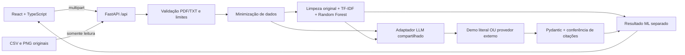

# Objetivo e arquitetura

A saída ao vivo agora usa extração de evidências e composição no servidor, sem
nota numérica; vetores TF-IDF vazios produzem abstenção. A estrutura geral abaixo
continua válida; o contrato público foi atualizado em API/OpenAPI.
Na entrega final, perguntas foram removidas e os erros do provedor têm códigos distintos.

O TalentMatch AI apoia a leitura de currículos em relação a vagas. Não é um ATS,
cadastro de candidatos, mecanismo de rejeição ou decisão de contratação. Faz parte
do TDE2 de Sistemas de Informação Inteligentes da PUCPR.

## Componentes implementados

`preprocess.py` e `models/` foram reutilizados. `llm.py` agora é compartilhado
com FastAPI e Streamlit. A aplicação original continua como alternativa de
execução. O backend usa caminhos absolutos relativos ao repositório, não ao
diretório corrente do processo.

## Decisões

- Sem banco, autenticação ou retenção permanente. Análises ficam no estado React.
  Atualizar a aba apaga o resultado individual; sair da comparação apaga seu estado.
  Download cria arquivo somente por ação do usuário.
- Serviços separados para classificador, arquivos, privacidade e experimentos.
  Pydantic define o contrato de análise; OpenAPI é exportado em `docs/openapi.json`.
- Pipeline local carregado uma vez com cache; processamento síncrono executado em
  threadpool para não bloquear o loop de eventos do FastAPI.
- Se a etapa LLM falhar, retornar HTTP 200 com ML válido, `llm=null` e `llm_error`.
  Falhas de entrada/modelo usam erro HTTP. Não há fallback silencioso para simulação.
- Fluxo padrão com LLM; demo apenas explícita: ML real, contexto simulado por termos conhecidos. Não
  usa chave nem provedor. Seu indicador é ilustrativo e sua fórmula é visível.
- Comparação de 2–5 currículos, processados sequencialmente e identificados pela
  ordem de envio. Falhas por documento são preservadas. Nenhuma ordenação por nota.
- CSV original só contém acurácia/F1; exibir ausências em vez de preencher valores.
  A matriz é servida como imagem original, sem inventar uma matriz numérica.
- Tailwind + componentes oficiais shadcn/ui adaptados aos aliases locais. Interface
  React com roteamento, gráficos Recharts, cores verde/floresta e layout responsivo.

## Segurança e privacidade efetivas

O backend minimiza currículo E vaga na fronteira com o provedor, inclusive quando
chamado pelo Streamlit. Regex remove contatos, CPF, datas completas, links, campos
pessoais rotulados e alguns cabeçalhos. Isso pode remover informação útil e deixar
dados pessoais fora dos padrões: não é anonimização garantida.

Textos são serializados como campos JSON em mensagem de usuário; instruções do
sistema os tratam como dados não confiáveis. Sem ferramentas, execução de código
ou acesso a links. Saída passa por schema, indicador inteiro limitado e conferência
de citações: evidência no currículo e requisito na vaga; itens de experiência
também devem ser trechos literais. Isso não prova relevância, veracidade ou ausência
de manipulação. Revisão humana permanece necessária.

Timeout de 45 segundos, sem retries pagos automáticos, resposta limitada a 3.500
tokens. Até 20.000 caracteres minimizados do currículo no LLM, com aviso de corte;
vaga até 16.000. Dados pessoais ou chaves não são incluídos nas mensagens de log.
Erros de validação não devolvem os valores rejeitados. Cache HTTP desabilitado.

Uploads podem usar spool temporário do framework; são fechados após a leitura.
Corpo completo limitado a 25 MB mais 100 KB de metadados; cada arquivo a 5 MB.
Não há promessa de apagar memória física, logs do sistema operacional ou retenção
do provedor externo. A API destina-se ao uso local, sem exposição pública.

## Fontes técnicas

- [FastAPI: arquivos](https://fastapi.tiangolo.com/tutorial/request-files/)
- [shadcn/ui: Vite](https://ui.shadcn.com/docs/installation/vite)
- [Tailwind com Vite](https://tailwindcss.com/docs/installation/using-vite)

Os detalhes de payload da integração foram verificados pelo SDK instalado e por
simulação HTTP local. O provedor externo configurado não foi chamado nesta execução.
