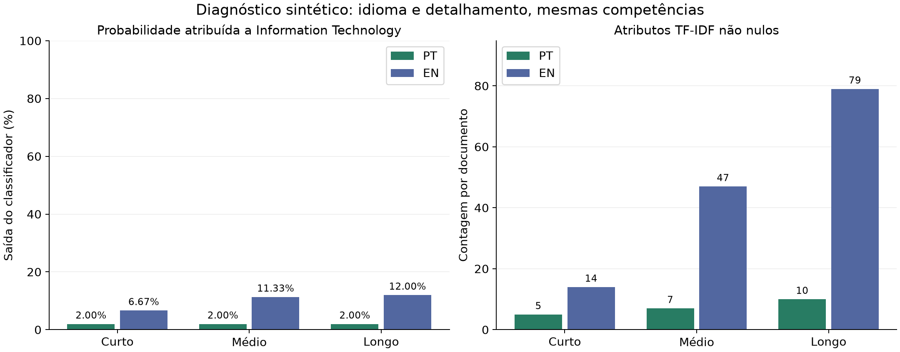
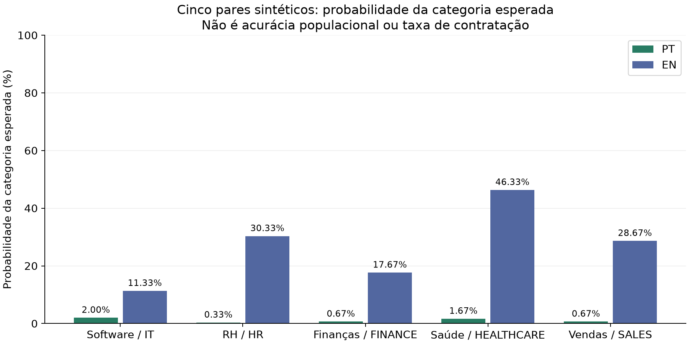
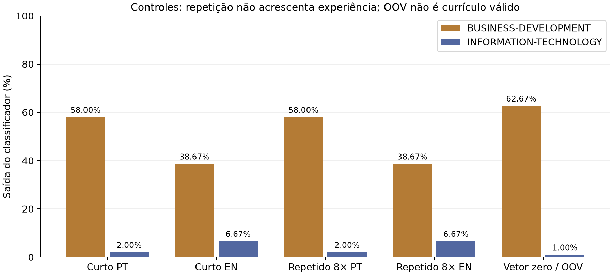

# Investigação de qualidade do classificador — TalentMatch AI 2.0

> Este documento preserva os resultados do diagnóstico anterior às correções.
> As lacunas de validação e vetor vazio abaixo foram tratadas na etapa seguinte:
> [correções de confiabilidade](confiabilidade.md). Dados, gráficos e métricas
> históricos não foram reescritos; os testes de caracterização afetados passaram
> a exigir os estados de abstenção documentados nessa atualização.

## Conclusão

**Há evidência local de efeito do idioma e do detalhamento, mas não de que apenas
traduzir ou alongar o currículo resolva a classificação.** O resultado observado
foi reproduzido exatamente. O modelo atual deve permanecer como baseline acadêmico,
com suas limitações expostas; não é adequado como classificação confiável de
currículos curtos em português. A prioridade futura é revisar dados e representação
textual e realizar novo treinamento com avaliação independente. Uma simples mudança
na limpeza da inferência não recupera termos que não existem no vocabulário aprendido.

Nenhum modelo, pipeline de produção ou frontend foi alterado. Não houve
retreinamento, chamada paga, commit ou push.

## 1. Metodologia e reprodução

- **14 currículos sintéticos:** seis versões de software (curta/média/longa × PT/EN)
  e quatro outras áreas em pares bilíngues (RH, finanças, saúde e vendas).
- **Cinco controles:** repetição oito vezes dos dois currículos curtos, texto fora
  do vocabulário, texto composto apenas por stop words e lista de termos técnicos.
- Todos os exemplos são fictícios. Rótulos esperados são hipóteses de diagnóstico,
  não anotações de um conjunto de avaliação representativo.
- Os seis textos de software mantêm dois anos de experiência e o mesmo conjunto
  técnico: Java, Spring Boot, PostgreSQL, APIs REST, Git, JUnit e Docker. As versões
  maiores detalham responsabilidades/projetos coerentes, sem acrescentar tecnologias.
  Angular e AWS aparecem apenas como requisitos da vaga, nunca como competências novas.
- Traduções humanas equivalentes foram definidas antes da execução. Não são
  perfeitamente idênticas em extensão: a contagem de palavras é registrada.
- Caminho principal: `minimize(text, resume=True)` → `limpar_texto` → TF-IDF original
  → `RandomForestClassifier.predict_proba`. O resultado é conferido com o serviço
  `predict()` usado pela aplicação. A vaga não entra no classificador ML.
- Comparações adicionais usam entrada bruta, limpa e minimizada; não alteram o
  pipeline. Vetores zero são controles de funcionamento, não currículos válidos.
- Não calculamos acurácia, precision, recall ou F1 sobre estes exemplos sintéticos.

Execute da raiz, com as dependências de `requirements.txt` já instaladas:

```powershell
.\.venv\Scripts\python.exe scripts/avaliar_modelo.py
.\.venv\Scripts\python.exe -m pytest -q
```

Fontes e resultados completos:

- [Entradas congeladas](../scripts/model_cases.json): todos os textos e a vaga.
- [Script reproduzível](../scripts/avaliar_modelo.py): inferência, inspeção e gráficos.
- [Tabela e textos efetivamente enviados ao TF-IDF](avaliacao-modelo/entradas-resultados.md).
- [CSV](avaliacao-modelo/resultados.csv) e [JSON completo](avaliacao-modelo/resultados.json),
  com as 24 probabilidades, atributos ativos, termos desconhecidos e hashes.
- Ambiente: Python 3.14.5, scikit-learn 1.9.1, pipeline original de 8.000 atributos,
  300 árvores e 24 classes. A aleatoriedade do treinamento já está incorporada no
  modelo serializado; nenhuma tradução automática ou geração remota foi utilizada.

Validação automatizada: **52 testes Python aprovados**, sendo nove novos testes
de diagnóstico/integração por mocks. Os testes que caracterizam comportamentos
indesejáveis passam ao reproduzir a falha; não são uma aprovação da qualidade do
modelo ou dos controles atuais. O ambiente emite apenas o aviso já conhecido de
depreciação do TestClient/httpx. Não há build de frontend nesta investigação, pois
nenhum arquivo dele foi alterado.

Uma segunda execução independente produziu JSON, CSV e Markdown gerado idênticos
(SHA-256 comparados). Os hashes dos três arquivos originais em `models/` também
continuaram iguais. Os gráficos podem ser regenerados a partir desses dados; os
SVGs podem conter metadados de exportação variáveis, sem alterar os resultados.

Os artefatos originais tiveram seus SHA-256 conferidos antes e depois:

```text
models/classificador.joblib   6eab51bf59878be2c57f158581f1247580b05e33a98eb973075cf3a8b2ae6294
models/comparacao_modelos.csv daa5b064887386f4256a0514609968237b8cefda54339507818a97be6e127566
models/matriz_confusao.png    c8b8c5aa62c1909be9634029f9647465a8c35d9a4f0e061fefdf6b98b5efd37c
```

## 2. Caso observado: reprodução e idioma

Currículo original fictício:

> Desenvolvedora de software com dois anos de experiência em Java, Spring Boot,
> PostgreSQL e APIs REST. Experiência com Git, testes unitários JUnit e Docker.
> Participação no desenvolvimento de sistemas empresariais.

Tradução equivalente:

> Software developer with two years of experience in Java, Spring Boot, PostgreSQL
> and REST APIs. Experience with Git, JUnit unit tests and Docker. Participation
> in the development of enterprise systems.

Vaga mantida como informada no pedido:

> Buscamos pessoa desenvolvedora Java para atuar com Spring Boot, APIs REST,
> PostgreSQL e Git. São desejáveis conhecimentos em Angular, AWS, Docker, testes
> automatizados e metodologias ágeis.

Categoria esperada apenas para diagnóstico: **INFORMATION-TECHNOLOGY**.

| Versão | 1ª categoria | 2ª categoria | 3ª categoria | P(Information Technology) |
|---|---|---|---|---:|
| Curta PT, 30 palavras | BUSINESS-DEVELOPMENT 58,00% | AVIATION 6,33% | CONSULTANT 3,67% | 2,00% |
| Curta EN, 30 palavras | BUSINESS-DEVELOPMENT 38,67% | ENGINEERING 9,00% | AVIATION 8,00% | 6,67% |

A tradução reduziu Business Development em **19,33 pontos percentuais** e elevou
IT em **4,67 pontos percentuais**, sem mudar a categoria vencedora. A posição das
demais classes mudou. Esses valores são saídas do classificador, sem evidência de
calibração; não são probabilidade de competência ou contratação.

O indicador demo **75/100** também foi reproduzido. O LLM **80/100** é um resultado
relatado pelo usuário, não reexecutado nesta investigação. O mock de integração
que devolve 80 é uma fixture de teste e não uma confirmação desse resultado real.

## 3. Idioma × quantidade de informação

Todas as entradas completas e as três maiores probabilidades estão no
[apêndice gerado](avaliacao-modelo/entradas-resultados.md). Aqui, BD significa
BUSINESS-DEVELOPMENT e IT significa INFORMATION-TECHNOLOGY.

| Variante | Palavras | Categoria prevista | Top 3 | P(IT esperada) | Atributos ativos |
|---|---:|---|---|---:|---:|
| Curta PT | 30 | BD | BD 58,00%; AVIATION 6,33%; CONSULTANT 3,67% | 2,00% | 5 |
| Média PT | 103 | BD | BD 58,00%; AVIATION 6,33%; CONSULTANT 4,00% | 2,00% | 7 |
| Longa PT | 231 | BD | BD 57,33%; AVIATION 6,33%; CONSULTANT 4,00% | 2,00% | 10 |
| Curta EN | 30 | BD | BD 38,67%; ENGINEERING 9,00%; AVIATION 8,00% | 6,67% | 14 |
| Média EN | 89 | BD | BD 25,67%; IT 11,33%; CONSULTANT 7,67% | 11,33% | 47 |
| Longa EN | 214 | BD | BD 12,33%; IT 12,00%; ENGINEERING 7,67% | 12,00% | 79 |



[SVG para exportação](avaliacao-modelo/idioma-detalhamento.svg).

**Evidência:** em inglês, o detalhamento elevou atributos ativos de 14 para 79 e
P(IT) de 6,67% para 12%. Em português, 30 → 231 palavras quase não alterou a saída;
P(IT) permaneceu em 2%. A versão longa em inglês ainda perdeu por 0,33 ponto
percentual para BD. Não houve acerto de software em nenhuma das seis variantes.

**Controle de tamanho:** repetir o currículo curto oito vezes aumentou cada texto
de 30 para 240 palavras, sem alterar sua distribuição de probabilidades. Portanto,
o efeito observado não é uma regra “mais caracteres = melhor classificação”. O
conteúdo lexical reconhecido, a frequência/normalização e o domínio do treinamento
importam; detalhamento e escolha de palavras não foram isolados como fatores causais
independentes. Esta análise não estabelece um comprimento mínimo confiável.

## 4. Diferentes áreas profissionais

Esperadas: software → IT; recursos humanos → HR; análise financeira → FINANCE;
enfermagem → HEALTHCARE; vendas → SALES. As classes esperadas existem no modelo.
Finanças pode compartilhar linguagem com BANKING/ACCOUNTANT, mas mantivemos FINANCE
como hipótese prévia em vez de trocar o rótulo após observar a saída.

| Área / idioma | Categoria prevista | Top 3 | P(categoria esperada) |
|---|---|---|---:|
| Software PT (médio) | BUSINESS-DEVELOPMENT | BD 58,00%; AVIATION 6,33%; CONSULTANT 4,00% | 2,00% |
| Software EN (médio) | BUSINESS-DEVELOPMENT | BD 25,67%; IT 11,33%; CONSULTANT 7,67% | 11,33% |
| RH PT | BUSINESS-DEVELOPMENT | BD 62,00%; AVIATION 6,67%; ARTS 3,00% | HR 0,33% |
| RH EN | HR | HR 30,33%; BD 18,00%; ADVOCATE 5,67% | HR 30,33% |
| Finanças PT | BUSINESS-DEVELOPMENT | BD 62,00%; AVIATION 6,67%; ARTS 3,00% | FINANCE 0,67% |
| Finanças EN | BUSINESS-DEVELOPMENT | BD 22,33%; FINANCE 17,67%; BANKING 13,00% | FINANCE 17,67% |
| Saúde PT | BUSINESS-DEVELOPMENT | BD 62,00%; AVIATION 6,67%; ARTS 3,00% | HEALTHCARE 1,67% |
| Saúde EN | HEALTHCARE | HEALTHCARE 46,33%; BD 13,67%; ADVOCATE 9,67% | HEALTHCARE 46,33% |
| Vendas PT | BUSINESS-DEVELOPMENT | BD 62,00%; AVIATION 6,67%; ARTS 3,00% | SALES 0,67% |
| Vendas EN | SALES | SALES 28,67%; BD 24,00%; AVIATION 6,00% | SALES 28,67% |



[SVG para exportação](avaliacao-modelo/areas-idiomas.svg).

Os quatro textos portugueses de áreas diferentes convergiram para a mesma saída
dominante com apenas 1–3 atributos ativos. Os ingleses tiveram 35–44 atributos
ativos. P(categoria esperada) aumentou nos cinco pares de comprimento médio, mas
isso não constitui estimativa de desempenho para todos os currículos em inglês.

## 5. O que chega ao TF-IDF

Para o currículo original, a limpeza produz:

```text
desenvolvedora de software com dois anos de experiência em java spring boot postgresql e apis rest. experiência com git testes unitários junit e docker. participação no desenvolvimento de sistemas empresariais.
```

A minimização não removeu nada em nenhum dos 14 casos. Para todos eles, as
distribuições obtidas com entrada bruta, limpa e minimizada/limpa foram iguais
(distância L1 = 0). Não foi encontrada divergência que explique estes erros entre
a limpeza usada no `train.py` atual e a inferência: ambos usam `limpar_texto`.
Isso verifica o código disponível, não reconstrói a execução histórica do treinamento.

O TF-IDF aprendido usa lowercase, unigramas/bigramas, stop words **inglesas**,
frequência sublinear e normalização L2. O tokenizador padrão exige pelo menos dois
caracteres de palavra. Termos fora do vocabulário são ignorados, não traduzidos.
Esses comportamentos são documentados pelo
[TfidfVectorizer do scikit-learn](https://scikit-learn.org/stable/modules/generated/sklearn.feature_extraction.text.TfidfVectorizer.html).

| Texto técnico | Saída da limpeza | O que é reconhecido pelo vocabulário |
|---|---|---|
| Java | java | java |
| Spring Boot | spring boot | spring; `boot` e o bigrama não existem |
| PostgreSQL | postgresql | nada |
| APIs REST | apis rest | rest; `apis` e o bigrama não existem |
| Git | git | nada |
| JUnit | junit | nada |
| Docker | docker | nada |
| C++ / C# (sondas adicionais) | c++ / c# | tokenizador não gera termos |
| .NET (sonda adicional) | .net | net, sem preservar a grafia original |
| 2 years (sonda adicional) | years | years; a limpeza remove o numeral |

Java, Spring Boot e APIs REST **não são apagados pela limpeza**. A principal perda
desse caso está no vocabulário aprendido e na tokenização, não na conversão para
minúsculas. Há perdas gerais relevantes, como números de experiência e linguagens
com símbolos; elas foram diagnosticadas, mas a função não foi modificada.

Os únicos cinco atributos ativos no original são `com`, `rest`, `java`, `spring`
e `software`. `com`, uma preposição portuguesa, recebe o maior peso TF-IDF nessa
entrada (0,59574). Peso TF-IDF alto não prova contribuição causal para a classe.
As coberturas de unigramas únicos são 5/22 no curto PT e 13/19 no curto EN; no longo,
10/119 e 76/90. Essas proporções são diagnósticos do vocabulário, não métricas de
qualidade ou distribuição de treinamento. O stop list inglês também afeta esse
denominador e impede tratá-lo como comparação linguística perfeitamente controlada.

## 6. Vetor quase vazio e distribuição das classes



[SVG para exportação](avaliacao-modelo/controles.svg).

- Vetor totalmente zero (texto OOV ou só stop words): **BD 62,67%**, AVIATION 6,67%,
  ARTS 3%. Não é currículo válido; é um controle de como as árvores percorrem
  caminhos quando nenhum atributo está presente.
- Somente termos técnicos `Java, Spring Boot, PostgreSQL, APIs REST, Git, JUnit,
  Docker.`: três atributos ativos; BD **62,33%**, P(IT) **1%**.
- Original PT: apenas **24 das 300 árvores** chegaram a folhas diferentes das
  usadas pelo vetor zero; longo PT: 27. Curto EN: 129; longo EN: 237. É uma medida
  de mudança de caminho, não uma decomposição causal da previsão.
- O serviço atual valida texto não vazio, mas não verifica `TF-IDF.nnz == 0` antes
  de classificar. Assim, texto sem vocabulário reconhecido ainda pode receber uma
  classificação aparentemente confiante. O teste de caracterização reproduz isso.

O dataset original não está disponível. Portanto, **não reconstruímos sua
distribuição real nem os rótulos de teste**. Foi possível recuperar do classificador
um metadado interno de 1.985 linhas de treino; as raízes das árvores também têm
soma ponderada de 1.985. Não inferimos daí tamanho do teste ou contagens por classe.

Como inspeção adicional, a média das proporções nas raízes dos 300 bootstraps é
aproximadamente IT **4,83%**, BD **4,79%**, HR **4,41%**, HEALTHCARE **4,63%** e
SALES **4,68%**. São amostras de treino com reposição, **não contagens exatas do
dataset**. As menores médias são BPO 0,90%, AUTOMOBILE 1,44% e AGRICULTURE 2,53%.
Há indícios de desequilíbrio entre algumas classes, mas não de BD ser uma maioria
de 58–63% no treinamento. O padrão dominante em entradas pobres em vocabulário
é consistente com os caminhos aprendidos para ausência de atributos; atribuí-lo
simplesmente à classe majoritária não é sustentado por esta inspeção.

`predict_proba` da floresta combina probabilidades das árvores; não é contagem
de palavras nem uma medida calibrada de certeza. Referência:
[RandomForestClassifier](https://scikit-learn.org/stable/modules/generated/sklearn.ensemble.RandomForestClassifier.html).

## 7. Integração com LLM: o que os mocks demonstram

Nove testes adicionais estão em
[test_model_quality.py](../backend/tests/test_model_quality.py). Eles passam sem
rede, usando `_client()` substituído por mock e credenciais fictícias. Nenhum teste
automatizado consulta o provedor real.

| Verificação | Resultado observado | Limite da conclusão |
|---|---|---|
| Área ML incorreta + resposta contextual fundamentada do mock | As evidências Java/Spring Boot/PostgreSQL/Git/Docker são aceitas; ML continua BD 58% e score mock continua 80/100 | Prova separação e validação do adaptador, não capacidade de um LLM real |
| Trocar BD por IT apenas no contexto passado ao adaptador | A resposta mock fixa é preservada | Não mede influência/ancoragem real; o mock foi programado para ser igual |
| Examinar payload e instruções | Área e confiança erradas são enviadas ao LLM; prompt diz que área é contexto, não prova de competência | Existe exposição a ancoragem; eficácia da instrução não foi medida |
| Evidência inventada de AWS | `unsupported_evidence`, LLM nulo e classificação ML preservada | A verificação literal funciona nesse caso |
| Resposta honesta com falta de informação e nota zero | Aceita, com listas vazias e explicação | Permite uma resposta cautelosa, mas não obriga o provedor a produzi-la |
| Resumo comercial indevido, nota 95 e nenhuma citação | **Aceito pelo contrato atual** | Lacuna: presença de citações é validada apenas se o provedor fornecer itens; resumo, habilidades e nota não têm obrigação de evidência |

Portanto, **não é possível afirmar que a classificação não influencia indevidamente
um LLM real**. O desenho compartilha esse contexto e pode favorecer ancoragem. Os
mocks revelaram uma lacuna concreta na validação de respostas sem evidência. Não a
corrigimos silenciosamente durante esta investigação; os testes documentam o
comportamento atual, incluindo o indesejável. Não substituímos o rótulo ML por uma
categoria sugerida pelo LLM.

Na interface existente, as probabilidades estão na classificação profissional,
enquanto o score é descrito como indicador heurístico/ilustrativo, com aviso de que
não é probabilidade estatística ou recomendação de contratação. A revisão foi por
leitura do componente e testes de contrato, sem alterações nem novo build do frontend.

### O que significa o 75/100 demonstrativo

O vocabulário da demo reconhece quatro termos da vaga: **Java, Git, Docker e AWS**.
Os três primeiros aparecem no currículo: **3/4 × 100 = 75**. Spring Boot,
PostgreSQL, Angular, APIs REST, JUnit e metodologias ágeis não compõem esse cálculo
por não estarem no vocabulário limitado da demo. Não é “75% de todos os requisitos”,
não depende da previsão BD e não é uma avaliação generativa. A origem do score 80
relatado do LLM não pode ser auditada sem a resposta original e execução autorizada.

## 8. Limitações do diagnóstico

- Amostra pequena, sintética, sem sorteio, sem anotadores independentes ou avaliação
  estatística. Tradução, palavras e estrutura das frases também influenciam.
- Não selecionamos novos exemplos após obter os resultados para esconder falhas.
  As seis variantes de software e os cinco pares de áreas estão integralmente publicados.
- Ausência do CSV original impede auditar cobertura do treinamento, rótulos,
  duplicações, distribuição exata, qualidade das categorias e possíveis vazamentos.
- Importâncias globais por impureza, disponíveis no JSON, não provam causas
  individuais nem ausência de vieses. Categorias com títulos explícitos aparecem
  entre os termos importantes; isso não prova vazamento de rótulos.
- Sem experimento ao vivo, não medimos qualidade, variação de notas, justiça ou
  resistência à ancoragem do LLM. Mocks não substituem essa avaliação.
- Acurácia original 75,05% e F1 macro 0,6896 continuam sendo os números do experimento
  original. Não foram recalculados, anulados ou extrapolados para português por estes casos.

## 9. Recomendações

### Manter agora

Preservar o modelo como **baseline acadêmico histórico**, com demonstração honesta
de falhas. Não usá-lo como critério de exclusão ou categoria confiável para estes
currículos. Manter scores de aderência e previsão profissional separados.

### Melhorar pré-processamento, mas avaliar de forma consistente

Investigar preservação de termos com símbolos, números relevantes e padrões técnicos,
além de tokenização/vocabulário adequados aos idiomas. Não adicionar palavras a
`vocabulary_`, traduzir silenciosamente ou mudar apenas a inferência: isso pode
desalinhar atributos/árvores e não ensina o modelo a reconhecer PostgreSQL/Docker.
Qualquer nova representação deve ser ajustada no treino e aplicada identicamente
na inferência, com comparação controlada ao pipeline preservado.

Um teste futuro de tradução pode ser realizado como transformação explícita e
separada, com origem/idioma registrados; os resultados atuais mostram que tradução
sozinha não garante acerto. Não a aplicar como correção automática nesta etapa.

### Prioridade de próxima etapa: dados + novo treinamento

1. Recuperar/versionar o dataset e auditar rótulos, duplicatas, idiomas e distribuição.
2. Criar avaliação independente com currículos reais autorizados ou anonimização
   adequada, variação de extensão e tecnologias atuais. Separar validação para escolha
   do teste final; não usar os 14 exemplos como treino ou evidência de generalização.
3. Comparar representação por palavras e n-gramas de caracteres, corpus bilíngue ou
   alternativas multilíngues. Reavaliar regressão logística/linear e floresta sob as
   mesmas divisões; não assumir que trocar apenas o algoritmo resolve o vocabulário.
4. Relatar métricas por classe/idioma, confusões, calibração e incerteza. Preservar
   um conjunto final que não tenha orientado escolha de modelos e regras.
5. Definir, após avaliação, quando **abster-se de emitir categoria** por ausência
   de atributos/idioma não suportado. Não usar somente um limiar de confiança:
   o vetor zero já recebeu 62,67% para uma categoria inadequada.
6. Fortalecer contrato do LLM para exigir evidência ou abstenção explícita de
   conclusões/score, e verificar consistência entre resumo, requisitos e citações.
   Considerar não passar a área ML na análise contextual até avaliar seu benefício.

Para medir ancoragem numa etapa autorizada: executar pares de prompts com o mesmo
currículo/vaga e contexto ML correto, incorreto e omitido; repetir com parâmetros
controlados e revisar evidências sem revelar a condição ao avaliador. Não há
autorização implícita para essas chamadas pagas nesta investigação.

## 10. Impactos para o TDE2

- O fluxo e os modelos continuam demonstráveis, mas a categoria profissional não
  deve ser apresentada como confirmação do perfil. Mostrar a falha é parte da
  análise crítica, não motivo para editar números ou escolher apenas casos favoráveis.
- Os gráficos deste relatório podem complementar os slides de resultados e limitações.
  Rotular sempre “diagnóstico sintético” e manter os dados originais de avaliação
  separados. Não chamar os gráficos de nova acurácia ou desempenho em português.
- O exemplo Java mostra por que classificação ML e evidências da vaga são problemas
  distintos. O score demo deve ser explicado com seu denominador de quatro termos.
- Se a disciplina exigir integração LLM efetiva, a simulação e os mocks não a
  comprovam. Demonstrar uma execução previamente autorizada com dados fictícios e
  declarar o risco de ancoragem e as lacunas de evidência identificadas.
- Prioridade recomendada: **manter o baseline para comparação, preparar novo
  treinamento para evolução**, com dados/representação adequados. Ajustar só a
  limpeza atual não é solução suficiente para os erros reproduzidos.
